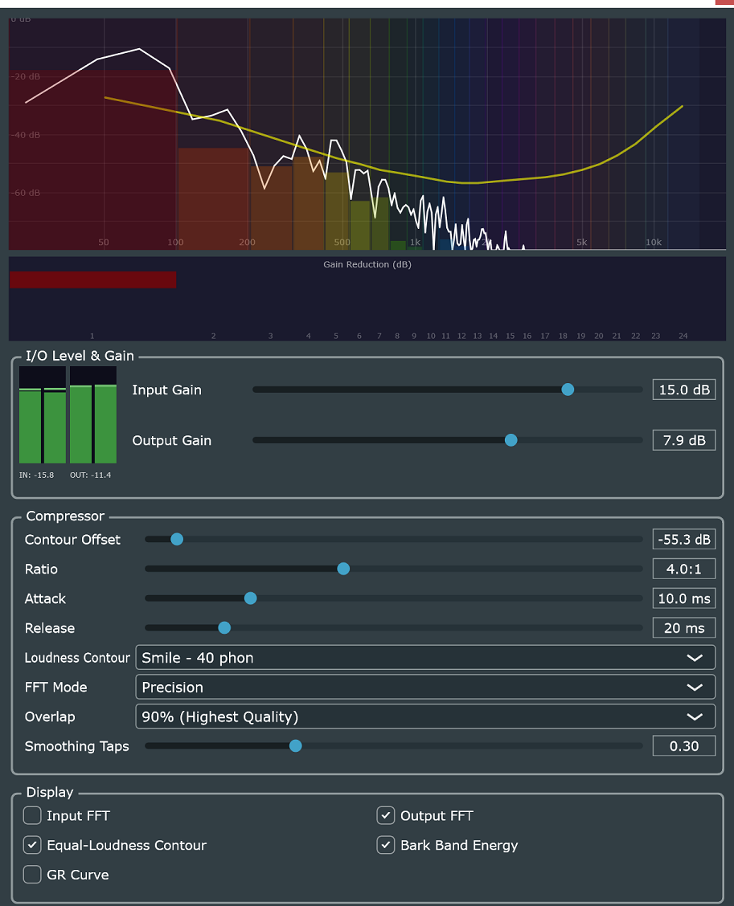

# PHU Bark FFT Compressor

[](https://github.com/huberp/phu-bark-fft-compressor/actions/workflows/build.yml)
[](https://github.com/huberp/phu-bark-fft-compressor/actions/workflows/release.yml)
[](https://github.com/huberp/phu-bark-fft-compressor/releases)
[](LICENSE)
[](#building)
[-purple.svg)](#building)
[](#building)
[](https://juce.com)
[](#intel-mkl-accelerated-fft)
[](https://ko-fi.com/phuplugins)

A stereo spectral compressor that operates independently on each of the 24 psychoacoustic Bark bands. Compression thresholds follow a selectable equal-loudness contour (ISO 226 or a hand-tuned "Smile" curve), so gain reduction tracks how the human ear actually perceives loudness rather than raw amplitude. Available as VST3 (Windows, Linux, macOS) and AU (macOS).



---

## Contents

- [Highlights](#highlights)
- [User Guide](#user-guide)
  - [Installation](#installation)
  - [Quick Start](#quick-start)
  - [Controls](#controls)
  - [Reading the Display](#reading-the-display)
  - [Where to Place It](#where-to-place-it)
  - [Latency and CPU](#latency-and-cpu)
- [Building](#building)
- [Architecture](#architecture)
- [License](#license)

---

## Highlights

🎛️ **Bark-band spectral compression** — the audio spectrum is divided into 24 perceptual Bark bands (matching the human auditory system's critical bands). Each band is compressed independently, so a loud kick drum cannot push down the detail in a vocal or hi-hat.

📐 **Equal-loudness contour threshold shaping** — each band's threshold is the selected contour value plus the **Contour Offset**. Choose from four ISO 226 curves (20, 40, 60 or 80 phon), four hand-tuned "Smile" curves, or a flat curve. The contour raises the thresholds towards the bass and treble extremes, where the ear is least sensitive, so compression concentrates on the region the ear hears best. A single **Contour Offset** control then sets how aggressively the whole spectrum is compressed.

🚀 **Intel® MKL-accelerated FFT** — Windows x64 builds are linked against the Intel® oneAPI Math Kernel Library (Intel® MKL), which JUCE's FFT engine uses for the forward and inverse transforms. The FFT is the dominant CPU cost of a spectral compressor, particularly at 75% and 90% overlap. MKL is linked statically, so there are no extra DLLs to install. See [Intel® MKL-accelerated FFT](#intel-mkl-accelerated-fft).

🧈 **Smooth, ringing-free gain** — the 24 band gains are not applied as 24 hard steps. They are interpolated across log-frequency between the band centres and optionally smoothed per bin (**Smoothing Taps**), which avoids the pre-echo and ringing that a stepped spectral gain curve would cause.

🔗 **Stereo-linked detection** — the analysis uses the combined (L+R) spectrum and the resulting gain is applied identically to both channels, so the stereo image is preserved.

⚡ **Two FFT modes** — *Precision* mode uses a larger FFT window (2048 / 4096 samples) for fine frequency resolution; *Transient* mode uses a smaller window (1024 / 2048 samples) for tighter time-domain response. Both modes can be run with 50%, 75% or 90% overlap-add with a periodic Hann window for transparent reconstruction.

📊 **Live spectral display and metering** — the spectrum view overlays the input and/or output FFT curve against colour-coded Bark band regions and the selected contour. A 24-bar gain reduction panel shows per-band compression activity in real time using the same colour coding. Input and output gain stages (±24 dB) with stereo RMS meters make level matching easy.

---

## User Guide

### Installation

1. Download the latest release from [Releases](https://github.com/huberp/phu-bark-fft-compressor/releases). Release zips are provided for Windows x64, Windows ARM64 and Linux x64. For macOS (VST3 + AU), [build from source](#building).
2. Copy the `.vst3` bundle to your DAW's VST3 folder:
   - Windows: `C:\Program Files\Common Files\VST3\`
   - Linux: `~/.vst3/` or `/usr/lib/vst3/`
3. Rescan plugins in your DAW
4. Load **PHU BARK FFT COMPRESSOR** on any stereo track or bus

**Windows:** Requires the [Microsoft Visual C++ 2015–2022 Redistributable (x64)](https://aka.ms/vs/17/release/vc_redist.x64.exe). Already present if Visual Studio 2019 or 2022 is installed.  
**Linux:** No external dependencies — the binary is self-contained.

The plugin is **stereo in / stereo out** and supports sample rates up to 192 kHz.

### Quick Start

1. Insert the plugin on a track, group bus or the master and play the loudest part of the material.
2. Enable **Output FFT** and watch the spectrum. The yellow contour line is the threshold the compressor works against.
3. Lower the **Contour Offset** until the gain reduction panel starts showing activity in the bands you want to control. Lower values move the thresholds down and increase gain reduction across the board.
4. Set **Ratio**, **Attack** and **Release** to taste. The compressor is downward-only and has **no automatic makeup gain**.
5. Use **Output Gain** to compensate for the level change and compare with the plugin bypassed at equal loudness.

The defaults (Contour Offset −30 dB, Ratio 4:1, Attack 10 ms, Release 100 ms, Smile 40 phon contour, Precision mode, 50% overlap, Smoothing 0.30) are a reasonable starting point.

### Controls

**I/O Level & Gain group**

| Parameter | Range | Description |
|---|---|---|
| Input Gain | −24 … +24 dB | Gain applied before the compressor. Raising it pushes more of the signal over the thresholds. |
| Output Gain | −24 … +24 dB | Gain applied after the compressor. Use it for makeup gain and level matching. |
| IN / OUT meters | — | Stereo RMS meters (30 ms window) with numeric dB readout below each pair. |

**Compressor group**

| Parameter | Range | Description |
|---|---|---|
| Contour Offset | −60 … +20 dB | Shifts the entire equal-loudness contour up or down. Lower values increase gain reduction across the board; higher values make the compressor more selective. |
| Ratio | 1:1 … 20:1 | Per-band compression ratio applied when a band's energy exceeds its threshold. At 1:1 the compressor is transparent. |
| Attack | 0.1 … 500 ms | Time for gain reduction to engage after a band crosses threshold. |
| Release | 1 … 2000 ms | Time for gain reduction to recover after a band falls below threshold. |
| Loudness Contour | ISO 226 20/40/60/80 phon, Smile 20/40/60/80 phon, Flat | Selects the curve that shapes the per-band threshold. Lower-phon curves raise the thresholds more towards the bass and treble extremes, concentrating compression on the mid-range. Higher-phon curves are flatter. *Flat* applies the same threshold to every band. |
| FFT Mode | Precision / Transient | Precision: larger FFT for better frequency resolution. Transient: smaller FFT for faster time response and lower latency. |
| Overlap | 50%, 75% or 90% | Overlap of the FFT frames. Higher values give smoother, higher-quality results at a higher CPU cost. |
| Smoothing Taps | 0 … 1 | Bidirectional IIR smoothing of the per-bin gain curve across frequency. 0 = no smoothing, 1 = maximum smoothing. |

**Display group**

| Toggle | Effect |
|---|---|
| Input FFT | Shows the pre-compression spectrum as a white curve. |
| Output FFT | Shows the post-compression spectrum. |
| Equal-Loudness Contour | Overlays the active contour (yellow). |
| Bark Band Energy | Draws coloured bar regions showing per-band signal energy. |
| GR Curve | Overlays the smoothed per-bin gain reduction curve on the gain reduction panel. |

### Reading the Display

- **White curve** — FFT of the input and/or output signal on a log-frequency / dB axis.
- **Yellow line** — the active contour. Band energy above this line (plus the Contour Offset) is compressed.
- **Coloured regions** — the 24 Bark bands. The filled bars show each band's current energy.
- **Gain Reduction panel** — one bar per Bark band, using the same colours; longer bars mean more gain reduction (scale 0 … −30 dB).

### Where to Place It

The plugin works on the *spectral balance* of a signal. It reacts to which frequency regions are too prominent relative to a loudness contour, rather than to overall level. This makes it most useful on dense, broadband material where many bands carry energy. These are suggested starting points, not rules — let your ears decide.

| Position | Suitability | Notes |
|---|---|---|
| **Group / mix bus** (drums, vocals, guitars, synth stacks) | ⭐ Best fit | Evens out the spectral balance of a whole group and tames build-ups or resonances that several sources create together. Use *Transient* mode on drum groups and *Precision* mode on sustained material (vocals, pads, keys). |
| **Master bus** | ✅ Good, with restraint | A gentle spectral leveller for the whole mix. Try low ratios (about 1.5:1 to 2.5:1), slower attack and release, and aim for only a few dB of gain reduction. Insert it before any final limiter. |
| **Single track** | ⚠️ Possible | Can tame resonances on a single source, but every instance adds latency and CPU load. Sparse sources only trigger a few bands. Prefer a group bus. |
| **While recording / live monitoring** | ❌ Not recommended | The plugin reports a latency of tens of milliseconds (see below). Use it during mixing and mastering. |

Because the gain is stereo-linked, it is safe to use on stereo buses without shifting the image.

### Latency and CPU

The plugin reports its latency to the host, so a DAW with plugin delay compensation (PDC) keeps everything in time. The reported latency is `2 × FFT size`:

| Mode | Latency (44.1 – 96 kHz) |
|---|---|
| Precision | 4096 / 8192 samples (about 85 – 93 ms) |
| Transient | 2048 / 4096 samples (about 43 – 46 ms) |

- The overlap setting does **not** change the latency, only the CPU load. Relative to 50%, 75% overlap processes about twice as many FFT frames and 90% about five times as many.
- Set **FFT Mode** and **Overlap** before playback. Changing them while audio is running re-initialises the compressor, which can cause a brief dropout and changes the reported latency.
- Mixing at 50% overlap and switching to 75% or 90% for the final bounce is a good way to save CPU.
- On Windows x64 builds, [Intel® MKL](#intel-mkl-accelerated-fft) reduces the cost of the FFT work.

---

## Building

### Prerequisites

| Tool | Requirement |
|---|---|
| CMake | 3.31.6 or newer |
| C++ compiler | C++20 — Visual Studio 2026 (Windows presets), or a current GCC / Clang |
| Git | Required at configure time. JUCE 8.0.15 and [phu-audio-lib](https://github.com/huberp/phu-audio-lib) are downloaded automatically by CMake (`FetchContent`) |
| Intel® MKL | Optional — oneAPI install or the NuGet package `intelmkl.static.win-x64` — for FFT acceleration |

### Clone

```bash
git clone https://github.com/huberp/phu-bark-fft-compressor.git
cd phu-bark-fft-compressor
```

There are no submodules to initialise; JUCE and phu-audio-lib are fetched into the source tree the first time CMake configures the project.

### Intel® MKL-accelerated FFT

`USE_INTEL_MKL` is `ON` by default. At configure time CMake looks for Intel® MKL in this order: the `MKLROOT` CMake variable, the `MKLROOT` environment variable, then (Windows) the local NuGet cache. `MKLROOT` should point to either the oneAPI MKL root (`.../mkl/latest`) or the NuGet native root (`.../intelmkl.static.win-x64/<version>/build/native`).

- **Found:** the plugin is compiled with `JUCE_DSP_USE_INTEL_MKL=1` and linked statically against MKL (sequential, no OpenMP runtime). The release builds for Windows x64 are built this way.
- **Not found:** CMake prints a status message and falls back to JUCE's built-in FFT. The plugin behaves identically, only slower on the FFT.
- **Disable explicitly:** pass `-DUSE_INTEL_MKL=OFF`.

Intel® MKL has no ARM64 binaries, so Windows ARM64 builds always use the JUCE FFT. The Linux x64 release builds also use the JUCE FFT; to use MKL on Linux, install oneAPI MKL (static libraries under `$MKLROOT/lib/intel64`) and set `MKLROOT` before configuring.

### Windows

```powershell
# Find the CMake executable (it may not be on PATH in all environments)
.\scripts\find-cmake.ps1

cmake --preset windows-x64-vst3-release
cmake --build --preset windows-x64-vst3-release-build
```

Use `windows-arm64-vst3-release` / `windows-arm64-vst3-release-build` for ARM64.

**With Intel® MKL (NuGet package):**
```powershell
# Example NuGet path
$env:MKLROOT = "$env:USERPROFILE\.nuget\packages\intelmkl.static.win-x64\2026.0.0.901\build\native"
cmake --preset windows-x64-vst3-release
cmake --build --preset windows-x64-vst3-release-build
```

**With Intel® MKL (oneAPI install):**
```powershell
$env:MKLROOT = "C:\Program Files\Intel\oneAPI\mkl\latest"
cmake --preset windows-x64-vst3-release
cmake --build --preset windows-x64-vst3-release-build
```

Output: `build/windows-x64-vst3-release/src/phu-bark-fft-compressor_artefacts/Release/VST3/`

### Linux

```bash
sudo bash scripts/install-linux-deps.sh
cmake --preset linux-x64-vst3-release
cmake --build --preset linux-x64-vst3-release-build
```

Use `linux-arm64-vst3-release` / `linux-arm64-vst3-release-build` for ARM64.

**With Intel® MKL:** Set `MKLROOT` before running CMake:
```bash
export MKLROOT=/opt/intel/oneapi/mkl/latest
cmake --preset linux-x64-vst3-release
cmake --build --preset linux-x64-vst3-release-build
```

**Note:** The `export` command sets `MKLROOT` only for the current terminal session. To make it persistent, add the export to your shell profile (e.g., `~/.bashrc` or `~/.zshrc`).

If the build times out: `cmake --build --preset linux-x64-vst3-release-build -j2`

Output: `build/linux-x64-vst3-release/src/phu-bark-fft-compressor_artefacts/VST3/`

### macOS

```bash
cmake --preset macos-arm64-release      # or macos-x64-release on Intel Macs
cmake --build --preset macos-arm64-release-build
```

One configure builds both VST3 and AU. To build a single format, use `macos-arm64-release-build-vst3` or `macos-arm64-release-build-au`.

Output: `build/macos-arm64-release/src/phu-bark-fft-compressor_artefacts/Release/`

---

## Architecture

### Core Components

| Component | Location | Responsibility |
|---|---|---|
| `BarkFFTCompressor` | `lib/audio/BarkFFTCompressor.h` | Header-only FFT-based spectral compressor. 2048/4096-point (Precision) or 1024/2048-point (Transient) FFT with 50%, 75% or 90% overlap-add and a Hann window. Maps FFT bins to 24 Bark bands, computes per-band energy from the L+R spectrum, applies threshold/ratio/attack/release gain reduction relative to the selected contour, then interpolates the band gains to per-bin gains. |
| `EqualLoudnessContour` | `lib/audio/EqualLoudnessContour.h` | Per-band threshold offsets for the nine contour presets: four ISO 226 curves (computed, normalised so the minimum is 0 dB), four "Smile" curves (hand-tuned) and Flat. |
| `OLAWindow` | `lib/audio/OLAWindow.h` | Prebuilt overlap-add windows and scale factors for each FFT size / overlap combination. |
| `WindowedRMS` | `lib/audio/WindowedRMS.h` | Sliding-window RMS used by the four level meters. |
| `AudioSampleFifo` | `phu-audio-lib/audio/AudioSampleFifo.h` | Lock-free single-producer / single-consumer FIFO for transferring audio samples from the audio thread to the UI thread. Used to feed both input and output spectra to the display. |
| `FFTProcessor` | `phu-audio-lib/audio/FFTProcessor.h` | UI-thread FFT processor. Accumulates samples from an `AudioSampleFifo`, applies a Hann window, and runs a forward FFT to produce the magnitude spectrum drawn by `SpectrumDisplay`. |
| `SpectrumDisplay` | `src/SpectrumDisplay.h/cpp` | JUCE `Component` rendered at 60 Hz. Draws the log-frequency / dB spectrum, Bark-band colour regions and the contour overlay. |
| `LevelMeterComponent` | `src/LevelMeterComponent.h` | Stereo L/R level meter with ballistic display and peak hold, driven by the editor's timer. |
| `PluginProcessor` | `src/PluginProcessor.h/cpp` | `AudioProcessor` + APVTS. Owns `BarkFFTCompressor`, the input/output gain stages, the RMS meters and the two `AudioSampleFifo`s (input + output). APVTS atomic parameter pointers are read on the audio thread without locking. |
| `PluginEditor` | `src/PluginEditor.h/cpp` | UI layout (a stack of sections whose heights add up to the editor height) and 60 Hz refresh timer. Drains both FIFOs, triggers `FFTProcessor` updates, updates the meters, and paints the gain reduction panel. |

JUCE and phu-audio-lib are fetched by `cmake/PhuDependencies.cmake`; Intel® MKL detection lives in `cmake/ConfigureIntelMKL.cmake`.

### DSP Signal Path

```
processBlock (audio thread)
  ├─ Input gain (10 ms ramp) → input RMS meters
  ├─ Push L+R samples → InputFifo  (for UI input spectrum)
  │
  ├─ For each sample:
  │    └─ BarkFFTCompressor::processSample()
  │         ├─ Ring-buffer accumulation (L and R)
  │         ├─ Every hopSize samples:
  │         │    ├─ Hann-window + forward FFT (L and R)
  │         │    ├─ Combine to an (L+R)/2 analysis spectrum
  │         │    ├─ Compute power per Bark band (→ dBFS via kFFTNormDb)
  │         │    ├─ Compare to contour + Contour Offset threshold
  │         │    ├─ Per-band attack/release gain smoothing
  │         │    ├─ Interpolate band gains to per-bin gains (log-frequency)
  │         │    ├─ Optional bidirectional IIR smoothing across bins
  │         │    ├─ Multiply the L and R spectra by the same bin gains
  │         │    └─ Inverse FFT + overlap-add → output sample
  │
  ├─ Output gain (10 ms ramp) → output RMS meters
  └─ Push L+R samples → OutputFifo  (for UI output spectrum)

UI Timer (60 Hz)
  ├─ Drain InputFifo  → FFTProcessor (input)  → SpectrumDisplay
  ├─ Drain OutputFifo → FFTProcessor (output) → SpectrumDisplay
  ├─ Read per-band gain reduction from BarkFFTCompressor
  ├─ Update level meters from the audio thread's RMS atomics
  └─ repaint SpectrumDisplay and gain reduction panel
```

### Bark Band Mapping

The 24 Bark bands follow the standard critical-band scale defined by Zwicker (1961). FFT bins are mapped to bands at `prepare()` time using the formula:

$$\text{Bark}(f) = 13 \cdot \arctan\!\left(\frac{0.76\,f}{1000}\right) + 3.5 \cdot \arctan\!\left(\left(\frac{f}{7500}\right)^2\right)$$

Each band's threshold is the value of the selected contour at the band's centre frequency, offset by the **Contour Offset** parameter.

### FFT Mode & Latency

| Mode | FFT size (≤48 kHz) | FFT size (>48 kHz) | Latency |
|---|---|---|---|
| Precision | 2048 | 4096 | 4096 / 8192 samples (2 × FFT size) |
| Transient | 1024 | 2048 | 2048 / 4096 samples (2 × FFT size) |

Reported host latency is `2 × FFT size` — one full ring buffer cycle. Overlap mode controls FFT frame rate only; it does not change the output delay.

---

## License

[MIT](LICENSE)

Intel and the Intel logo are trademarks of Intel Corporation or its subsidiaries. Intel® oneAPI Math Kernel Library is subject to Intel's own license terms.
